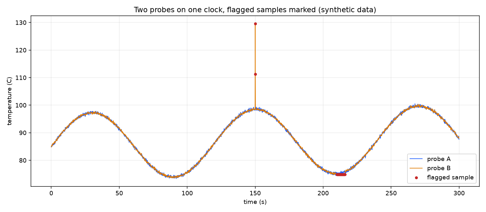

# sensor-data-quality-checks

[](https://github.com/AbhishekDubasi09/sensor-data-quality-checks/actions/workflows/ci.yml)
[](LICENSE)


Plausibility checks for sensor and measurement time series, in Python with pandas and NumPy:
time alignment, range check, rolling z-score, frozen-value detection and a cross-check between two
signals of the same quantity. The checks **flag** samples and keep them, with the reason, so a person
decides what to do. Nothing is deleted.



*Synthetic data: two temperature probes on separate clocks, with one spike and one stuck stretch
injected into probe B. Flagged samples are red.*

## Why

Before logged data from several sensors can be compared, it has to be on one clock, and its bad
samples have to be found. Typical problems are a clock offset between loggers, an implausible spike, and a
sensor that silently stops updating but stays inside the plausible range. Each of these is found by a
different check, which is why there are five of them and why they are reported separately.

## The checks

| Check | Function | What it finds |
|---|---|---|
| Time alignment | `align_to_reference` | Resamples a series onto a shared reference clock by linear interpolation, so two loggers can be compared sample by sample |
| Range | `range_flags` | Values that are physically impossible for the quantity |
| Rolling z-score | `zscore_flags` | Samples far from their *local* mean, in local standard deviations, so slow expected change is not flagged |
| Frozen value | `frozen_flags` | Every sample of a stretch of at least `min_run` equal values: a sensor that stopped updating |
| Cross-check | `cross_check_flags` | Two related signals that disagree by more than a limit: one of the two measurement chains has a problem |

`sensor_quality.pipeline.evaluate` runs all of them on two probes and returns one row per reference
sample, with one column per check and probe, a `flagged` column and a `reasons` column.

## Result on the synthetic run

The run is 300 s at 10 Hz (3000 reference samples). Probe B logs on its own clock, offset by 0.03 s with
+-10 ms jitter, so the probes line up only after alignment. Two faults are injected into probe B: a
single-sample spike of +40 C at 150 s, and a stuck value from 210 s to 216 s. These numbers come from
[`results/summary.json`](results/summary.json) and are reproduced by the command below.

| Quantity | Value |
|---|---|
| Aligned samples | 3000 |
| Flagged samples | 61 (2.03 %) |
| Correlation, probe A vs probe B | 0.9963 |
| Frozen-value flags, probe B | 59 |
| z-score flags, probe B | 1 |
| Cross-check flags | 2 |
| Flags on probe A (range, z-score, frozen) | 0 |
| Range flags | 0 |

- **The spike** appears on two neighbouring reference samples (150.0 s and 150.1 s), because it lies
  between them in time and interpolation shares it. Both are caught by the cross-check, and one also by
  the z-score.
- **The stuck stretch** is flagged from 210.1 s to 215.9 s (59 samples) and only by the frozen-value
  check. The value stays inside the plausible range, and inside the stretch the two probes differ by at most
  1.35 C, below the 5 C cross-check limit. The reference samples at 210.0 s and 216.0 s are not flagged:
  each lies between a moving and a stuck sample, so its interpolated value differs from the stuck one.
- **The range check found nothing**, by design: no injected value left the 0 to 150 C limits.

Every flagged row, with its reasons, is in [`results/flagged_samples.csv`](results/flagged_samples.csv);
all 3000 rows are in [`results/all_samples_with_flags.csv`](results/all_samples_with_flags.csv).

## Run it

```bash
pip install -e ".[dev]"
python -m pytest                       # 17 tests
python -m sensor_quality.demo --out results
```

The demo is deterministic for a given `--seed` (default 7).

```python
from sensor_quality import align_to_reference, frozen_flags, zscore_flags

aligned = align_to_reference(series, reference_t)
flags, z = zscore_flags(aligned, window=50, threshold=3.0)
stuck = frozen_flags(aligned, min_run=8)
```

## Choices worth knowing

- **Local, not global, statistics.** The z-score uses a centred rolling window (default 50 samples,
  threshold 3). A global mean would flag every part of a signal that legitimately moves.
- **A 3-sigma rule flags ordinary noise too.** About 0.3 % of normal samples exceed it by chance, so
  on long recordings a few isolated flags are expected. Treat them as candidates, not verdicts, and look at the other
  checks. In this synthetic run the z-score fired once on probe B and not at all on probe A.
- **Where the local standard deviation is zero** the z-score is undefined and is not flagged. The
  frozen-value check covers that case.
- **Flag, never delete.** Each flagged sample keeps its row and its reasons.

## Limitations

- The data is synthetic. Nothing here was measured on a real machine or vehicle, and the results say only
  that the checks find faults whose position is known.
- The thresholds (range 0 to 150 C, z-score window 50 and limit 3, frozen run of 8 samples, cross-check
  limit 5 C) were chosen for this data. Real signals need limits from their physics and their sensors.
- It is one run with one random seed. It is not a statistical evaluation of detection rates.
- Linear interpolation also bridges gaps. A long gap in the log is filled with a straight line, and
  that line is then treated as data. Check the gaps before aligning.
- Only two probes and five checks. There is no handling of more than two channels, of units, or of
  slowly drifting sensors.

## Layout

```
src/sensor_quality/   checks.py, pipeline.py, synthetic.py, demo.py
tests/                unit tests for each check and for the pipeline
results/              output of the demo run
docs/                 the figure above
```

## License

MIT, see [LICENSE](LICENSE).
